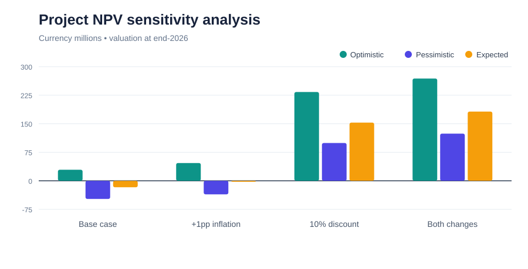
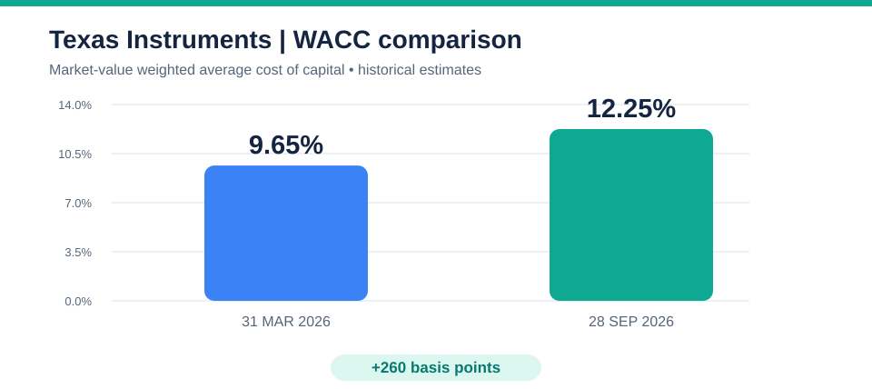

# Corporate Financial Management
**BAFI3257 · Master of Finance · RMIT University**

Two case studies in **capital budgeting, cost of capital and strategic financial decision-making**.

---

## Choose a case study

| | Assessment 1 · Project investment | Assessment 2 · Corporate advisory |
|---|---|---|
| **Question** | Is an AI subscription platform financially viable? | How did Texas Instruments' cost of capital and financing risk change? |
| **Analysis** | 10-year DCF, NPV, scenario sensitivity, expansion and abandonment options | CAPM/OLS beta, bond debt valuation, WACC, capital-structure and trade-shock stress tests |
| **Headline** | Expected NPV: **−$16.94m** before options, **+$5.91m** with optimal flexibility | WACC: **9.65% → 12.25%** (+260 bp); proposed planning hurdle rate **11%** |
| **View** | **[Explore the valuation case](assessment-1-project-valuation/README.md)** | **[Explore the Texas Instruments case](assessment-2-texas-instruments/README.md)** |

These cases were originally developed in a **student group**, then organised here for portfolio presentation. Assessment 1 includes a separately documented **AI-assisted Python model reconstruction**; Assessment 2 presents the final submitted analysis through concise, newly drawn visual summaries. Neither original group submission nor the raw licensed LSEG exports is included.

## Assessment 1 · Investment decision with real options

A hypothetical subscription-platform investment: cash flows, infrastructure replacements, working capital, and a terminal value. The study explains why a negative base expected NPV can become marginally positive if the company has the **option to expand** following stronger adoption.

[Case study and results](assessment-1-project-valuation/README.md) · [Python model](src/cfm/valuation.py) · [Model tests](tests/test_valuation.py) · [Methodology](docs/methodology.md)

## Assessment 2 · Texas Instruments cost-of-capital advisory

A historical comparison at **31 March and 28 September 2026**. The team estimated market-value WACC, assessed uncertainty in a four-year monthly beta regression, compared debt-cost methods and modelled leverage under a hypothetical trade shock.

[Case study and insights](assessment-2-texas-instruments/README.md) · [Beta analysis](assessment-2-texas-instruments/figures/beta-sensitivity.svg) · [Capital-structure stress](assessment-2-texas-instruments/figures/leverage-stress.svg)

## Capabilities illustrated

`Excel financial modelling` · `Python` · `Discounted cash flow` · `CAPM` · `Regression & beta estimation` · `Bond valuation` · `WACC` · `Real options` · `Scenario analysis` · `Risk communication`

## Reproducibility and attribution

- **Assessment 1:** Reproduce the companion Python calculations with `python scripts/run_analysis.py` and check the model with `python -m unittest discover -s tests -v`; the continuous-integration badge reports the test workflow.
- **Assessment 2:** Figures reproduce **reported results from the final submitted student slides**, not a new calculation from redistributable raw LSEG data. Numerical claims have not been independently re-audited in this documentation-only update.
- **Responsible sharing:** The original group work, course materials and LSEG data may have reuse restrictions. See [rights notice](NOTICE.md) and [publication checklist](docs/publication_checklist.md).

*Historical educational case studies. No RMIT or corporate endorsement is implied. This is not investment advice.*
