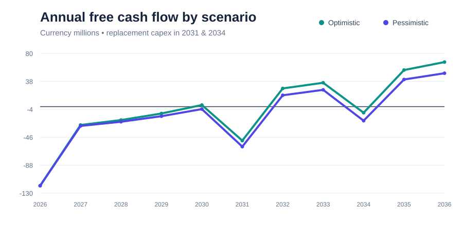
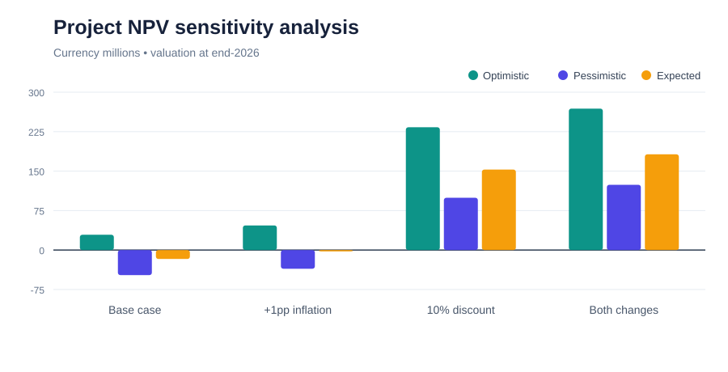
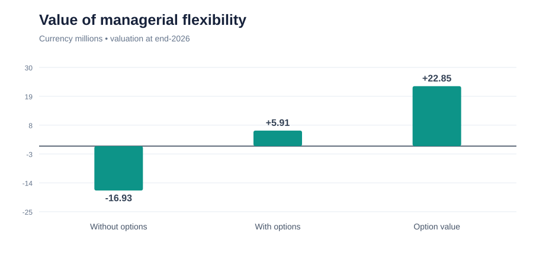
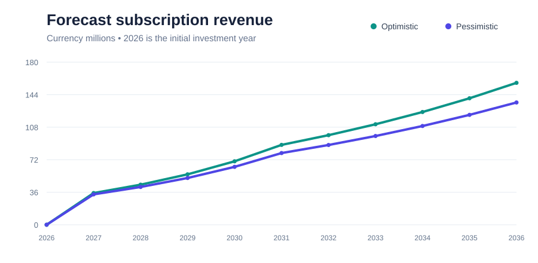

# Assessment 1 | AI Platform Valuation and Real Options

**RMIT University · Master of Finance · BAFI3257 · Collaborative coursework**

A portfolio-style reconstruction of an investment decision for a **hypothetical AI-powered subscription platform**. This project examines whether subscription growth can justify infrastructure investment, and how managerial flexibility changes the decision.

> **Collaborative coursework-based analysis.** This is an AI-assisted portfolio reconstruction, not the original assessment submission. This repository is currently publicly visible; check group permissions and university case-material rights before further redistribution. The original group submissions and restricted spreadsheets are excluded.

## Investment decision at a glance

| Metric | Value ($ millions) |
|---|---:|
| Optimistic base-case NPV | **+29.06** |
| Pessimistic base-case NPV | **−47.60** |
| **Probability-weighted NPV, without options** | **−16.94** |
| Optimistic expansion branch | **+86.18** |
| Expected NPV **with optimal real options** | **+5.91** |
| **Value of managerial flexibility** | **+22.85** |

**Conclusion:** The conventional expected NPV is negative, but the option to expand after favourable demand makes the modelled expected NPV marginally positive. This is *conditional*, not a robust unconditional approval: terminal value is a major driver and future infrastructure reinvestment may reduce economic value.

## Visual overview

### Projected cash flows by scenario


### NPV sensitivity to assumptions


### Effect of managerial options


### Subscription revenue path


## Sensitivity analysis

| Case | Optimistic | Pessimistic | Expected NPV |
|---|---:|---:|---:|
| Base case; 14% discount | +29.06 | −47.60 | −16.94 |
| Inflation +1 percentage point | +46.77 | −35.52 | −2.61 |
| Discount rate reduced to 10% | +233.36 | +99.34 | +152.95 |
| Both changes | +268.78 | +124.01 | +181.92 |

*Values are $ millions. Slight inflation-case differences from the collaborative spreadsheet are explained in the [audit notes](../docs/methodology.md).*

## Skills demonstrated

**Finance:** discounted cash flow, capital budgeting, terminal valuation, scenario analysis, probability weighting, working capital, real-option decision trees.  
**Analytics:** Python, parameterised inputs, automated model tests, CSV reporting and analytical visualisation.

## Repository guide

| Location | Contents |
|---|---|
| [config/assumptions.json](../config/assumptions.json) | Project inputs and scenario probabilities |
| [src/cfm/valuation.py](../src/cfm/valuation.py) | Reusable financial model |
| [scripts/run_analysis.py](../scripts/run_analysis.py) | Results export |
| [tests/test_valuation.py](../tests/test_valuation.py) | Model regression checks |
| [outputs/](outputs) | Reconciled CSV summaries |
| [figures/](figures) | GitHub-friendly SVG charts |
| [docs/methodology.md](../docs/methodology.md) | Methodology, assumptions and audit limitations |
| [docs/publication_checklist.md](../docs/publication_checklist.md) | Requirements before making the repository public |

## Reproduce results

Requires **Python 3.10+**. No third-party Python library is needed to run the valuation and tests.

```bash
python scripts/run_analysis.py
python -m unittest discover -s tests -v
```

Outputs in `outputs/` are regenerated from `config/assumptions.json`. SVG portfolio charts are committed for reliable in-browser preview.

## Attribution

The initial Excel analysis and written coursework submission were **collaboratively prepared by a student team**. This repository is a separately prepared, **AI-assisted Python reconstruction for portfolio demonstration**. It is not the original assignment submission; do not claim the reconstructed code was independently authored without reviewing and understanding it. No endorsement from RMIT University is implied.

*Illustrative case study, not investment advice.*
