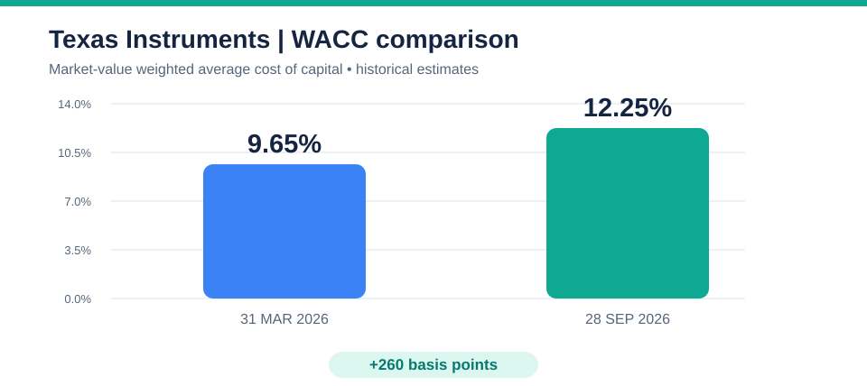
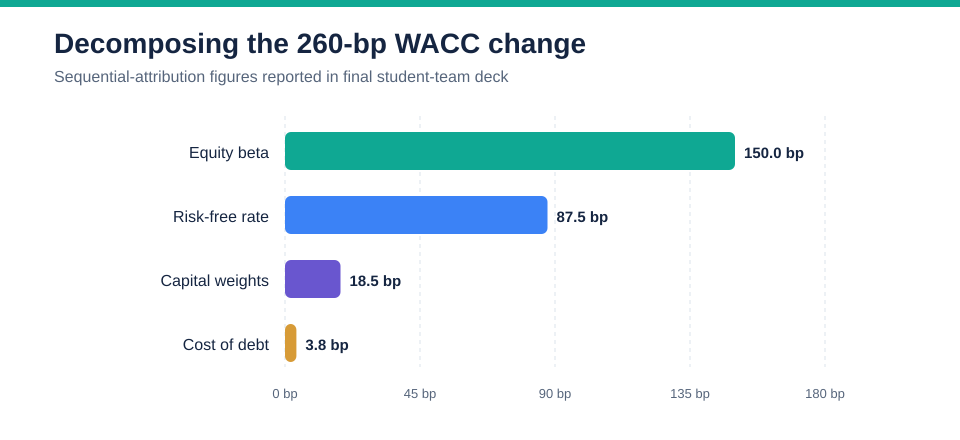
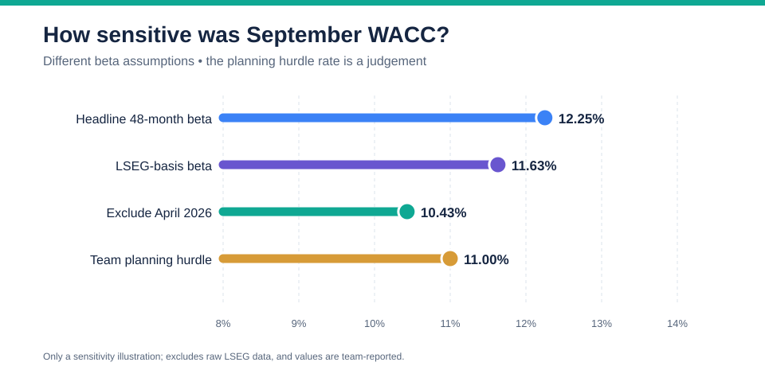
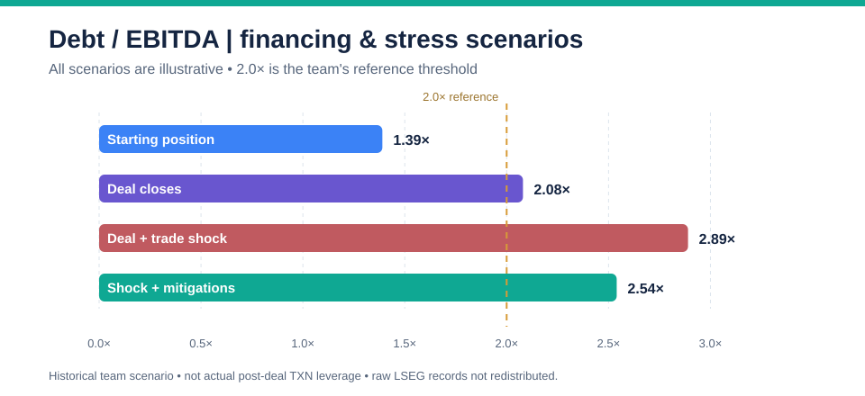

# Assessment 2 | Texas Instruments: Cost of Capital & Capital Structure

**BAFI3257 · RMIT University · Master of Finance · Team 6**  
**Observation dates:** 31 March 2026 and 28 September 2026 · **Company:** Texas Instruments (TXN)

[← Course portfolio](../README.md) · [Methods and limitations](methodology-and-limitations.md) · [Rights and attribution](attribution-and-sources.md)

> **Project type:** Historical corporate-finance advisory simulation, collaboratively prepared for university assessment. This page is a *portfolio summary of the final submitted presentation*, not a new live-market valuation. Proprietary LSEG datasets, raw exports, screenshots and the original team presentation are **not hosted here**.

## The financial question

How had the company's cost of debt and equity changed over six months, and did its debt structure remain appropriate under potential acquisition financing and a US–China trade shock?

The analysis compared two market-value capital structures, calculated CAPM cost of equity using a **48-month regression**, estimated debt cost using both bond-yield and CAPM approaches, and stressed coverage and leverage metrics under hypothetical scenarios.

## Executive conclusion

| Measure | 31 Mar 2026 | 28 Sep 2026 | Movement |
|---|---:|---:|---:|
| Risk-free rate (10-year US Treasury) | **4.30%** | **5.24%** | **+94 bp** |
| Equity beta (four-year monthly regression) | **1.149** | **1.471** | **+0.322** |
| CAPM cost of equity | **10.04%** | **12.59%** | **+255 bp** |
| Market-yield-based cost of debt (after default-loss adjustment, before tax) | **5.53%** | **6.23%** | **+70 bp** |
| Debt as proportion of firm market value | **6.89%** | **4.47%** | **−242 bp** |
| **Weighted average cost of capital (WACC)** | **9.65%** | **12.25%** | **+260 bp** |

**Interpretation from the submitted presentation:** WACC rose sharply on the specified valuation dates, but most of the increase beyond Treasury yields depended on a *noisy equity-beta re-estimate*. In a sensitivity check omitting one unusually influential month, the reported September WACC fell from **12.25% to 10.43%**. The team's **11% planning hurdle rate** was a judgement-based recommendation, not an independently observed market return.

## Why the 260-bp rise warrants caution

The team attributed approximately **150 bp** to its new beta estimate, **87.5 bp** to the higher risk-free rate, **18.5 bp** to market capital-structure weights and **3.8 bp** to the cost of debt, using sequential allocation. The estimates of these drivers are **order-dependent**, not causal effects.

- **Method:** OLS regression of monthly excess TXN returns against S&P 500 proxy excess returns using 48 observations, with short-term Treasury bills as the risk-free input for the regression.
- **Statistical uncertainty:** The submitted September beta was **1.471**, with a reported **95% confidence interval of 0.867–2.075**, and a reported regression R² of **0.34**.
- **Cross-check:** A separately estimated five-year raw-return beta was **1.3404**, compared with the LSEG-reported **1.34** on its basis.
- **Influential observation:** The team's sensitivity analysis excluded April 2026 and reported beta **1.089** and WACC **10.43%**.

The point is not that beta must be 1.089, but that the financing decision should not lean exclusively on a single imprecisely estimated beta.

## Capital-structure risk

The team's model reported market debt/firm value of **4.47%** as of 28 September 2026, alongside base gross debt/EBITDA of **1.39x** and EBITDA/interest of **17.4x**. Its hypothetical combined acquisition-and-trade-shock scenario reached **2.89x** gross debt/EBITDA, while free cash flow covered only **0.58x** of dividends.

The **scenario assumptions**, including a fall in sales to China, weaker global demand and wider credit spreads, were stress assumptions, *not forecasts*. An alternative funding and capital-return plan reduced the modelled stress leverage to **2.54x**.

### What the team recommended

1. Use **$3.0bn of cash** and **$4.5bn of debt** for the hypothetical acquisition funding mix rather than funding the whole purchase with new debt.
2. Pause buybacks until modelled leverage returns below **2.0x**.
3. Hold the dividend flat and reassess if the downside shock persists.
4. Address the **$1.85bn** of 2027–2028 debt maturities and preserve financing flexibility.
5. Use **11% as a provisional planning hurdle rate**, with a review after two quarters.

These are **historical student-team recommendations**, not a statement about actual current TXN decisions.

## Skills demonstrated

**Corporate finance:** CAPM, market-value WACC, bond valuation, debt tax shields, operating and financial risk separation, stress-case finance strategy.  
**Analytical methods:** Excel scenario modelling, OLS beta estimation, regression uncertainty, sensitivity analysis, cross-checking third-party data.  
**Communication:** board-style executive briefing, metric prioritisation and acknowledging model uncertainty.

## Explore the analysis

| Resource | What it covers |
|---|---|
| [Methodology and limitations](methodology-and-limitations.md) | Estimation choices, source provenance and sensitivity caveats |
| [Attribution and sources](attribution-and-sources.md) | Collaborative ownership and LSEG restrictions |
| [Key reported metrics (CSV)](reported-metrics.csv) | Small manually transcribed set of disclosed presentation outputs |
| [Course overview](../README.md) | Browse all three corporate finance cases |

*Figures are newly drawn from the final submitted deck's stated results. Raw LSEG data and university-provided materials are not redistributed.*
