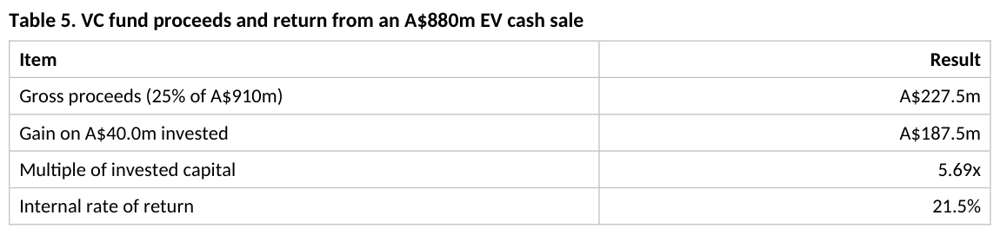

# NovaThera Pharmaceuticals venture capital exit

**Individual investment committee report · Pratham Kurele · RMIT Corporate Financial Management**

I recommended a negotiated sale to a strategic buyer, with an IPO as the fallback. The distinction was liquidity. A sale at A$880m enterprise value would pay the fund in cash. An A$95m primary IPO would fund the company and leave the fund with a 22.5% stake to sell later.

## What the fund would receive

The fund had invested A$40m for a 25% stake. Adding A$30m of cash to the proposed enterprise value gives A$910m of equity value. Under the case assumptions, the fund would receive **A$227.5m**, a **5.69× gross multiple** and a **21.5% gross internal rate of return**.

## How I compared the exits

I valued the business against peers, estimated a buyer’s shareable synergies and compared the timing of the fund’s cash receipts. At a 10% required return, the report valued the sale proceeds at A$211.8m today and the IPO route at A$167.9m. The comparison depends on the sale price and how quickly the fund could sell its listed stake.

*From my individual report, “NovaThera Pharmaceuticals: VC Exit Pathway Evaluation,” Tables 4, 5 and 8. The image is an excerpt of Table 5. NovaThera is an academic case.*

[Corporate finance projects](../README.md)
